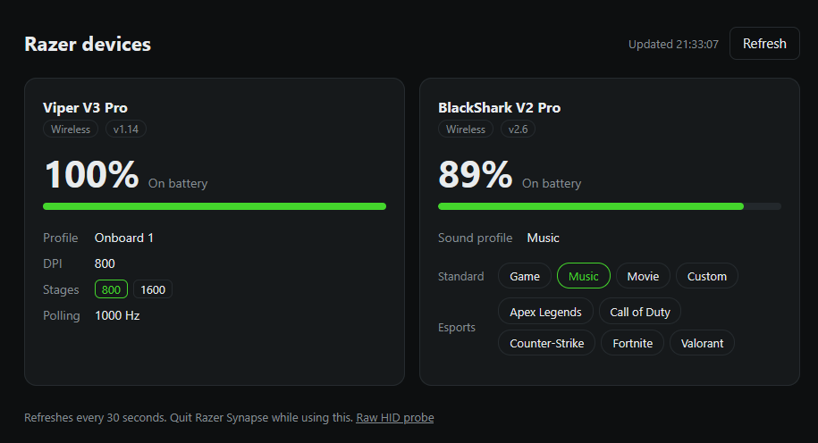

# webzer

This repo is just to avoid installing Synapse 🙂 I don't need its features, so I asked Opus 5.5 to build a web app that I open through an icon on my desktop.

It's built for me and my two devices, so I don't expect anyone else to use it.

| Device | Shows |
|---|---|
| Viper V3 Pro | Battery, charging, onboard profile, DPI and DPI stages, polling rate |
| BlackShark V2 Pro (2023) | Battery, charging, EQ preset, which I can switch from the page |

## Open it

Double-click the icon. The page opens in my default browser, and the helper stops about 3 minutes after I close the tab.

To set up the icon on a new machine:

1. Install [uv](https://docs.astral.sh/uv/) and run `uv sync` in the repo folder.
2. Create a desktop shortcut to `<repo>\.venv\Scripts\pythonw.exe razer_helper.py --open`.
3. Set the shortcut's **Start in** field to the repo folder.

`uv run razer_helper.py --open` does the same from a terminal.

## How it works

`razer_helper.py` talks to the devices over HID and serves the page on `localhost:8137`. The page can't do this itself, because Chrome's WebHID can't reach the mouse's Razer commands.

The HID protocols come from [OpenRazer](https://github.com/openrazer/openrazer) and [HaloBattery](https://github.com/HeyOkay/HaloBattery). Notes on them are in the comments in `razer_helper.py`.

## If something looks wrong

- If the mouse card shows `no interface answered (read error)`, the mouse is asleep. Move the mouse and click **Refresh**.
- If readings fail and Synapse is running, quit Synapse. It uses the same HID channel.
